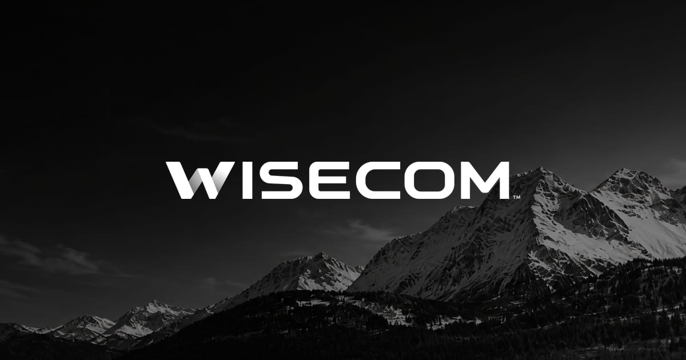

[](https://docs.atlas.wisecom.fi)

[](https://github.com/wisecom-oy/atlas/actions/workflows/ci.yml)
[](https://github.com/wisecom-oy/atlas/actions/workflows/e2e.yml)
[](https://github.com/wisecom-oy/atlas/actions/workflows/ci.yml)
[](https://www.npmjs.com/package/@wisecom/atlas-cli)
[](./LICENSE)

# Atlas

**Open-source backup and recovery for Microsoft 365, by [Wisecom](https://wisecom.fi).**

Atlas backs up Microsoft 365 to S3-compatible storage that you control, and restores from it. Data is encrypted before it leaves your machine, each unique item is stored once, and after the first run only changes are fetched.

**[Read the documentation](https://docs.atlas.wisecom.fi)** · [Quickstart](https://docs.atlas.wisecom.fi/getting-started) · [CLI reference](https://docs.atlas.wisecom.fi/reference/cli) · [SDK reference](https://docs.atlas.wisecom.fi/reference/sdk)

## What it protects

| Workload            | Covered                                                             |
| ------------------- | ------------------------------------------------------------------- |
| **Exchange Online** | Mailboxes, folder hierarchy, attachments                            |
| **Contacts**        | Personal Outlook contacts, with photos                              |
| **Calendar**        | Outlook calendar events, with recurring series and file attachments |
| **OneDrive**        | Files with version history                                          |
| **SharePoint**      | Document libraries, including subsites                              |
| **Microsoft Teams** | Channel messages and replies, with channel members and tabs         |

SharePoint lists and site pages, and Teams one-to-one, group, and meeting chats, are not covered yet. See the [roadmap](https://docs.atlas.wisecom.fi/roadmap).

## Why Atlas

- **Your storage, your keys.** Backups go to any S3-compatible backend: AWS, MinIO, or on-premises. Each tenant is encrypted with its own key, so access to the storage alone does not expose mail or files.
- **Immutable when you need it.** S3 Object Lock retention is enforced by the storage layer, not by the application.
- **Fast after the first run.** Only changes are fetched, and identical content is never stored twice.
- **Verifiable.** Every snapshot can be checked end to end, and restored from a replica kept by your storage provider.
- **Open.** Apache-2.0, no licence key, no feature gating, no proprietary archive format.

The [security model](https://docs.atlas.wisecom.fi/security) explains the encryption, the threat model, and what Atlas does and does not protect against.

## Get started

```bash
npm install -g @wisecom/atlas-cli

atlas outlook backup -m user@example.com
atlas onedrive backup -o user@example.com
atlas sharepoint backup --site https://contoso.sharepoint.com/sites/Engineering
```

Backups need a Microsoft Entra ID app registration and an S3 bucket. The [quickstart](https://docs.atlas.wisecom.fi/getting-started) walks through both.

| I want to                              | Go to                                                                           |
| -------------------------------------- | ------------------------------------------------------------------------------- |
| Run my first backup                    | [Quickstart](https://docs.atlas.wisecom.fi/getting-started)                     |
| Grant the right Microsoft permissions  | [Entra ID app registration](https://docs.atlas.wisecom.fi/azure-ad-setup)       |
| Host storage and schedule runs         | [Self-hosting](https://docs.atlas.wisecom.fi/self-hosting/)                     |
| Restore, verify, or export             | [CLI reference](https://docs.atlas.wisecom.fi/reference/cli)                    |
| Embed Atlas in a Node.js application   | [SDK reference](https://docs.atlas.wisecom.fi/reference/sdk)                    |
| Fix a failed run                       | [Troubleshooting](https://docs.atlas.wisecom.fi/troubleshooting)                |
| Upgrade from v6                        | [Migrating to v7](https://docs.atlas.wisecom.fi/migration/v7)                   |

**Packages:** [`@wisecom/atlas-cli`](https://www.npmjs.com/package/@wisecom/atlas-cli) for the command line, [`@wisecom/atlas-sdk`](https://www.npmjs.com/package/@wisecom/atlas-sdk) for the Node.js API.

## Wisecom Continuity

Atlas is the engine. Running it in production also means scheduling, monitoring, alerting on failed runs, restore testing, and keeping credentials and retention under control.

If you would rather not run that yourself, Wisecom operates Atlas as a managed service, [Wisecom Continuity](https://wisecom.fi/en/products/continuity), with automated onboarding and monitoring, self-service restore, and options for keeping backup data in storage your own organisation controls.

Both paths use the same open engine and the same storage format, so self-hosting is a supported choice, not a trial.

## Contributing

Issues and pull requests are welcome. [CONTRIBUTING.md](./CONTRIBUTING.md) covers setup, code conventions, the architecture, and pull request expectations.

```bash
pnpm install
pnpm run build
pnpm run test
```

When reporting a bug, include the output of `./tools/diagnostics.sh` and replace real mailbox addresses, file names, and site URLs with generic placeholders.

## Security

If you believe you have found a vulnerability, report it privately through [wisecom.fi/en/contact](https://wisecom.fi/en/contact) rather than opening a public issue.

## Support Atlas

Atlas is developed and maintained by [Wisecom Oy](https://wisecom.fi). Sponsorship helps keep it maintained, reliable, and free.

❤️ [Sponsor Wisecom Oy on GitHub](https://github.com/sponsors/wisecom-oy)

## License

Copyright 2026 Wisecom Oy (Y-tunnus: 3629087-1)

Licensed under the Apache License, Version 2.0. See [LICENSE](./LICENSE) for details. The Atlas and Wisecom names and logos are trademarks of Wisecom Oy and are covered by [`assets/LICENSE.md`](./assets/LICENSE.md), not by Apache-2.0.
