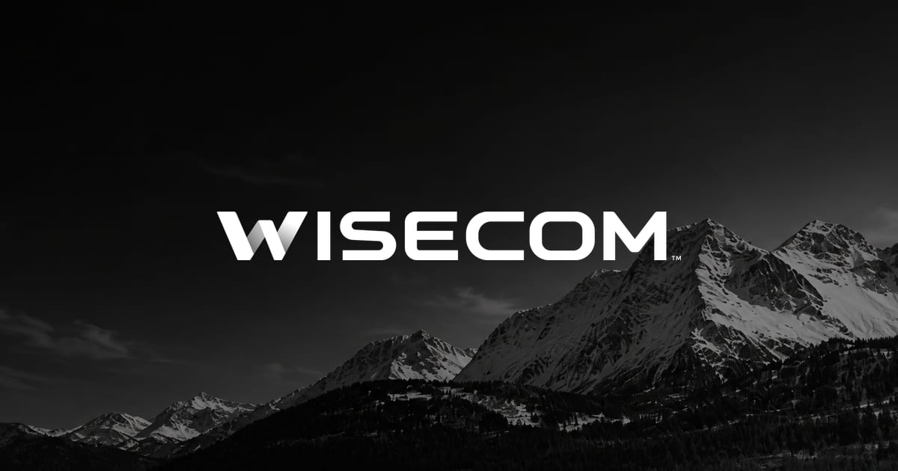

[](https://docs.atlas.wisecom.fi)

# @wisecom/atlas-sdk

**The Node.js API for Atlas, the open-source Microsoft 365 backup engine by [Wisecom](https://wisecom.fi).**

**[Documentation](https://docs.atlas.wisecom.fi)** · [SDK reference](https://docs.atlas.wisecom.fi/reference/sdk) · [Examples](https://docs.atlas.wisecom.fi/reference/examples) · [GitHub](https://github.com/wisecom-oy/atlas) · [Wisecom Continuity](https://wisecom.fi/en/products/continuity)

Atlas backs up Microsoft 365 to S3-compatible object storage that you control, and restores from it. This package embeds it in your own application.

Use it for custom schedulers, multi-tenant services, backup portals, and automation that needs typed control over Outlook mail, contacts, calendars, OneDrive, SharePoint, and Teams. All internal modules are bundled, so this package installs alone with no peer `@wisecom/atlas-*` dependencies.

## Requirements

- Node.js 22.8 or later

## Install

```bash
npm add @wisecom/atlas-sdk
```

Beta releases use the `beta` dist-tag:

```bash
npm add @wisecom/atlas-sdk@beta
```

## Quick start

Pass credentials and tenant configuration when you create the instance. The SDK does not read environment variables, `.env`, or config files.

```ts
import { createAtlasInstance } from '@wisecom/atlas-sdk';

const atlas = createAtlasInstance({
  tenantId: '<tenant-id>',
  clientId: '<client-id>',
  clientSecret: '<client-secret>',
  s3Endpoint: 'http://localhost:9000',
  s3AccessKey: '<access-key>',
  s3SecretKey: '<secret-key>',
  encryptionPassphrase: '<passphrase>',
});

// Outlook backup
await atlas.outlook.backup('user@example.com');

// OneDrive backup
await atlas.onedrive.backup('user@example.com');

// Contacts backup
await atlas.contacts.backup('user@example.com');

// Calendar backup
await atlas.calendar.backup('user@example.com');

// SharePoint backup: pass a site URL or Microsoft Graph site ID, add subsites when needed
await atlas.sharepoint.backup('https://contoso.sharepoint.com/sites/Engineering', {
  includeSubsites: true,
});

// Teams backup: one team per call, identified by its Microsoft Graph team ID
await atlas.teams.backup('<team-id>');
```

## Validating configuration

`createAtlasInstance` checks the configuration synchronously and makes no network requests. It throws `ConfigError` for:

- a missing required field,
- a passphrase shorter than 14 UTF-8 bytes,
- an S3 endpoint that is not an absolute HTTP(S) URL, or that embeds credentials, a query, or a fragment.

Once the tenant bucket exists, `await atlas.validate()` is an optional read-only check of S3 access, the existing wrapped tenant key, and Microsoft Graph token issuance:

| Failure                                  | Throws                 |
| ---------------------------------------- | ---------------------- |
| Wrong passphrase for an existing backup  | `WrongPassphraseError` |
| S3 failure                               | `StorageError`         |
| Microsoft Graph token failure            | `AuthError`            |

A fresh tenant with no wrapped key still passes. The check never creates key material, writes objects, tests write permissions, or checks workload-specific Graph consent. See the [SDK reference](https://docs.atlas.wisecom.fi/reference/sdk#validation).

Upgrading from v6? See the [v7 migration guide](https://docs.atlas.wisecom.fi/migration/v7). From v5, start with the [v6 migration guide](https://docs.atlas.wisecom.fi/migration/v6).

## Running in production

- **Streaming exports.** `atlas.outlook.save(snapshotId, { output: res })` pipes the archive to any Node `Writable`, so an HTTP download never stages on local disk. See [streaming exports](https://docs.atlas.wisecom.fi/reference/sdk#streaming-exports).
- **Storage metrics.** Pass `onStorageRequest` to receive one event per S3 request with its latency, connection-pool queueing, retries, payload size, and outcome, for example to feed OpenTelemetry histograms. It works against any S3-compatible backend and never carries object keys, bucket names, or hostnames. See [storage request events](https://docs.atlas.wisecom.fi/reference/storage-request-events).
- **Concurrency.** Run one operation at a time per tenant unless your scheduler guarantees that no two operations touch the same mailbox, drive owner, or site. When several processes work on one tenant, pass a `throttleCoordinator` so that when Microsoft Graph throttles one process (HTTP 429), the others pause too. See [concurrent operations](https://docs.atlas.wisecom.fi/reference/sdk#concurrent-operations).

## API overview

| Namespace or method       | Purpose                                                                       |
| ------------------------- | ----------------------------------------------------------------------------- |
| `atlas.outlook`           | Mailbox backup, restore, save, verification, catalog, and deletion            |
| `atlas.onedrive`          | OneDrive backup, restore, file version restore, save, verification, and deletion |
| `atlas.contacts`          | Contacts backup, restore, verification, and deletion                          |
| `atlas.calendar`          | Calendar backup, restore, verification, and deletion                          |
| `atlas.sharepoint`        | SharePoint site backup, restore, file version restore, save, verification, and deletion |
| `atlas.teams`             | Teams channel backup, verification, export, snapshot catalog, and deletion    |
| `atlas.keys`              | Re-wrap and purge data key wrappers across tenants that share the passphrase  |
| `atlas.getBucketStats()`  | Storage statistics                                                            |
| `atlas.getStorageUsage()` | Physical bytes in the bucket: versions, staging, incomplete uploads           |
| `atlas.checkStorage()`    | S3 Object Lock and conditional-write readiness                                |
| `atlas.validate()`        | S3 access, existing key, and Microsoft Graph token validation                 |
| `createTenant()`          | A second tenant to pass as a restore's `targetTenant` (cross-tenant restore) |

The SDK exports named public option and result types, error classes, `GRAPH_SERVICE_LIMITS`, `getGraphCost`, `getStorageUsageToken`, and `isFileStorageContainerSite`. Internal ports, DI tokens, and container factories are not public API.

`@wisecom/atlas-sdk/contract` exports the rules an application applies outside an SDK call, such as the passphrase floor (`MIN_PASSPHRASE_BYTES`, `isAcceptablePassphrase`), the bucket naming rules (`tenantBucketName`, `isValidBucketName`), the owner and team ID forms Atlas keys backups by (`canonicalSiteId`, `normalizeOwnerId`, `parseTeamId`), `isFileStorageContainerSite`, and `GRAPH_SERVICE_POOLS`. It has no Node or third-party dependencies, so it bundles for a browser or a Worker. See [Contract values](https://docs.atlas.wisecom.fi/reference/sdk#contract-values).

## CLI alternative

For shell-based operations, cron jobs, and operator workflows, use [`@wisecom/atlas-cli`](https://www.npmjs.com/package/@wisecom/atlas-cli).

## Documentation

Everything else lives at **[docs.atlas.wisecom.fi](https://docs.atlas.wisecom.fi)**:

| Topic                                 |                                                                                         |
| ------------------------------------- | --------------------------------------------------------------------------------------- |
| Every method, option, and error       | [SDK reference](https://docs.atlas.wisecom.fi/reference/sdk)                            |
| Working code for common tasks         | [Examples](https://docs.atlas.wisecom.fi/reference/examples)                            |
| Microsoft Entra ID permissions        | [Entra ID app registration](https://docs.atlas.wisecom.fi/azure-ad-setup)               |
| Storage metrics                       | [Storage request events](https://docs.atlas.wisecom.fi/reference/storage-request-events) |
| Encryption and threat model           | [Security model](https://docs.atlas.wisecom.fi/security)                                |
| Upgrading                             | [Migrating to v7](https://docs.atlas.wisecom.fi/migration/v7)                           |

## Wisecom Continuity

Atlas is free to run yourself, with no licence key and no feature gating. If you would rather not operate backups, Wisecom runs Atlas as a managed service: [Wisecom Continuity](https://wisecom.fi/en/products/continuity), with automated onboarding and monitoring and self-service restore. Both use the same open engine and the same storage format.

## License

Code is licensed under Apache-2.0, Copyright 2026 [Wisecom Oy](https://wisecom.fi).

The Atlas and Wisecom names and logos are trademarks of Wisecom Oy and are not covered by that licence. See [`assets/LICENSE.md`](https://github.com/wisecom-oy/atlas/blob/main/assets/LICENSE.md) in the repository.
